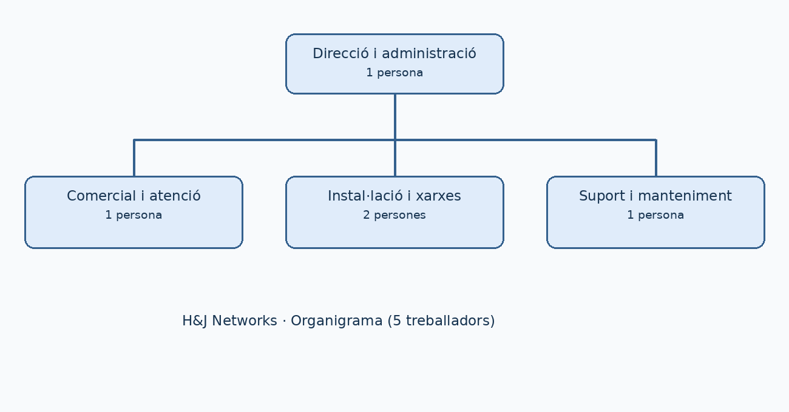

# 02. Departaments i estructura organitzativa

## 1. Organització general

H&J Networks és una microempresa de cinc treballadors. Per això, algunes funcions es compartixen i no és necessari crear molts departaments independents.

| Àrea o departament | Treballadors | Funcions principals |
|---|---:|---|
| Direcció i administració | 1 | Organitzar l'empresa, facturació, pressupostos i compres |
| Comercial i atenció al client | 1 | Contactar amb clients, preparar propostes i gestionar sol·licituds |
| Instal·lació i xarxes | 2 | Instal·lar cablejat, routers, switches, WiFi i equips de client |
| Suport i manteniment | 1 | Atendre incidències, fer revisions i documentar intervencions |
| **Total** | **5** | |

## 2. Llocs de treball

### Direcció i administració (1 persona)

Coordina els projectes, revisa els pressupostos, controla els ingressos, tramita factures i organitza el calendari de treball.

### Comercial i atenció al client (1 persona)

Escolta les necessitats dels bars i restaurants, prepara les ofertes amb ajuda de l'equip tècnic, fa seguiment dels clients i programa les visites.

### Tècnics o tècniques de xarxes (2 persones)

Instal·len cablejat i equips, configuren xarxes WiFi i cablejades, comproven la connexió de TPV i impressores i documenten les configuracions bàsiques.

### Tècnic o tècnica de suport (1 persona)

Rep incidències, fa diagnòstics, resol problemes senzills a distància, visita clients quan cal i organitza revisions preventives.

## 3. Organigrama

L'organigrama està guardat en la carpeta `img/` i es mostra a continuació:

## 4. Coordinació entre àrees

Quan un client demana una instal·lació, l'àrea comercial recull les necessitats; direcció valida el pressupost; els dos tècnics executen la instal·lació; i suport s'encarrega del seguiment i de les incidències. Esta organització evita duplicar tasques i facilita que el client tinga un punt de contacte clar.
